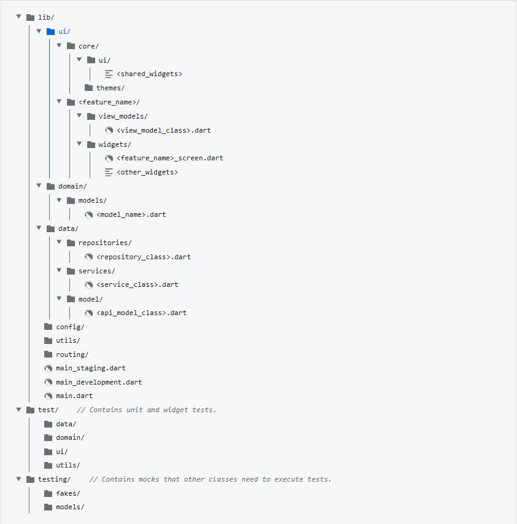

# Balamandian

A Flutter Android client. This README records the agreed architecture and code
organization, adapted from Flutter's [Compass architecture case study](https://docs.flutter.dev/app-architecture/case-study#package-structure),
architecture guide, and recommendations. These are principles to apply as the
app grows, rather than a requirement to reproduce every Compass directory.

Current implementation (architecture-related files):

```text
lib/
  main.dart                       # Entry point: launches the app.
  app.dart                        # Root widget and MaterialApp configuration.
  routing/
    app_router.dart               # Application route table and router factory.
  ui/
    core/
      themes/
        app_theme.dart            # Shared application theme.
    home/
      widgets/
        home_screen.dart          # Existing starter screen.
test/
  routing/
    app_router_test.dart          # Router wiring and lifecycle checks.
```

`main.dart` launches `MainApp`; `app.dart` owns the root `MaterialApp.router`
and router lifecycle. The only route is `/`, displaying the static home screen.
The app has a shared default light theme and one routing widget test. There are
no view models, repositories, services, application models, or API integrations.
The static screen does not need placeholder MVVM components.

Agreed architecture and future organization:

Use Compass's hybrid organization: group UI code by feature and shared data code
by type. Keep the existing `lib/ui/<feature>/` layout, without adding a separate
`features/` level. The table defines placement conventions; create future paths
only alongside code needed by a real feature.

| Location | Responsibility | Current status |
| --- | --- | --- |
| `lib/ui/<feature>/widgets/` | Feature screen and its local widgets. | Exists for `home`. |
| `lib/ui/<feature>/view_models/` | Presentation logic, UI state, and user-action methods. | Future. |
| `lib/ui/core/ui/` | Widgets shared across features. | Future. |
| `lib/ui/core/themes/` | Shared theme configuration. | Exists. |
| `lib/data/repositories/` | Sources of truth organized by application data type. | Future. |
| `lib/data/services/` | External API access and response decoding; no application data state. | Future. |
| `lib/data/model/` | API-specific response/request models when a separate representation is needed. | Conditional future path, using Compass's singular `model/` name. |
| `lib/domain/models/` | Immutable application data types consumed by the data and UI layers. | Future. |
| `lib/routing/` | Application route configuration. | Exists. |

Views render state and forward user actions to their view models. Keep business
and data-access logic out of widgets; layout, animation, and simple navigation
remain view responsibilities. Pair a view with a view model when it needs
presentation logic; this does not mean one view model per individual widget.
Keep `main.dart` minimal and `app.dart` as the root application configuration.

Data boundaries:

The Flutter client communicates with Balamandian-API. Integration with SIS-API
belongs to the main backend. The dependency direction is
`View -> ViewModel -> Repository -> Service -> Balamandian-API`; widgets and view
models do not call services directly.

View models consume repository contracts; repositories privately consume services
and expose application models. Data and resulting state updates flow back toward
the UI. Repositories own data updates and the data policies a feature actually
requires. Keep repositories independent of each other; combine their outputs in
the view model, or an optional use case when warranted.

Introduce focused abstract repository contracts and their required implementations
with the consuming feature and approved API contract. Inject services and
repositories through constructors and wire dependencies at the application
composition point when needed. Separate API models from application models only
when their shapes or responsibilities differ. Placing data types in
`domain/models/` does not require a domain use-case layer.

Testing and deliberately deferred structure:

Keep unit and widget tests in `test/`, mirroring the relevant `lib/` paths as
components are added; `test/routing/` already follows this convention. Test new
services, repositories, and view models independently, and views with widget
tests. Introduce fakes alongside tests that need them. A separate `testing/`
subpackage is only justified by actual shared test-support requirements.

Defer HTTP-package selection, environment configuration, authentication storage,
error conventions, caching, retries, and offline support until feature requirements
and the API contract justify them. Do not pre-create empty folders, speculative
endpoints, generic base repositories, a dependency-injection container, or code
generation. Add use cases only when complex or repeated logic warrants them.
Compass's `config/`, `utils/`, and separate environment entry points are examples,
not a checklist: introduce them only for concrete configuration, reusable
utilities, or distinct startup requirements. State management, dependency
injection packages, and model code generation remain feature-driven decisions;
Compass's particular package choices are not prerequisites for these boundaries.

Navigation (current foundation and future conventions):

Navigation uses Flutter's recommended `go_router` package with
`MaterialApp.router`. The route table lives in `lib/routing/app_router.dart`;
the only registered destination is `/`, which displays the existing home screen.
`MainApp` owns one router for its widget lifecycle, retains it across rebuilds,
and disposes it when removed. `main.dart` remains only an entry point, and the
existing application theme is still applied at the app root.

Add real destinations to the route table when their features exist. Widgets
can use go_router's context navigation methods for simple navigation. Keep
session and authorization decisions out of feature widgets; introduce router
redirects or guards that consume the actual application state once authentication
and screen access policies are specified. Client routing will not replace
server-side authorization.

Authentication redirects, session refresh behavior, roles and access rules,
post-login destinations, tab shells, nested navigators, and state restoration
are deferred until their requirements exist. Native app-link configuration is
also deferred; adopting a declarative router alone does not configure it.
Unmatched locations currently use go_router's built-in error handling; a custom
not-found experience awaits an approved design. No placeholder routes, access
policies, navigation wrappers, or route code generation are included.

Navigation references:

- [Flutter navigation and routing](https://docs.flutter.dev/ui/navigation)
- [Flutter architecture recommendations](https://docs.flutter.dev/app-architecture/recommendations)
- [go_router configuration](https://pub.dev/documentation/go_router/latest/topics/Configuration-topic.html)
- [go_router redirection](https://pub.dev/documentation/go_router/latest/topics/Redirection-topic.html)
- [MaterialApp.router](https://api.flutter.dev/flutter/material/MaterialApp/MaterialApp.router.html)

Theming (current baseline and future conventions):

The application theme is defined once in `lib/ui/core/themes/app_theme.dart`
and applied by `MaterialApp` in `lib/app.dart`. It uses `ThemeData.light()`,
preserving Flutter's existing Material 3 colors, typography, and component
defaults. The starter screen inherits its styling without local overrides.

No approved in-app palette, typography specification, component styles, or
dark-mode requirements were found in this repository. Launcher and splash
branding define assets and white backgrounds for those native surfaces; they
do not establish an in-app palette. The current theme is a technical baseline,
not an approved Balamandian visual design.

As design specifications become available, configure the theme's `colorScheme`
and `textTheme` centrally. Use `ColorScheme.fromSeed` if the approved design calls
for a generated palette, or supply the specified color roles directly. Add
component themes for approved shared styles when those components are used.
Custom widgets should read semantic values from `Theme.of(context).colorScheme`
and `Theme.of(context).textTheme`. Standard Material widgets already inherit
the app theme. Dark-theme support and theme switching await product requirements.

Theming references:

- [Flutter design and theming](https://docs.flutter.dev/ui/design)
- [Flutter themes cookbook](https://docs.flutter.dev/cookbook/design/themes)
- [Material Design for Flutter](https://docs.flutter.dev/ui/design/material)
- [ThemeData configuration](https://api.flutter.dev/flutter/material/ThemeData/ThemeData.html)
- [Default light theme](https://api.flutter.dev/flutter/material/ThemeData/ThemeData.light.html)
- [MaterialApp theme](https://api.flutter.dev/flutter/material/MaterialApp/theme.html)

Architecture references:

- [Flutter architecture guide](https://docs.flutter.dev/app-architecture/guide)
- [Flutter architecture recommendations](https://docs.flutter.dev/app-architecture/recommendations)
- [Compass case study and package structure](https://docs.flutter.dev/app-architecture/case-study)
- [Compass data-layer case study](https://docs.flutter.dev/app-architecture/case-study/data-layer)

Android development baseline and release limitations:

Observed on 2026-10-31 from the installed Flutter SDK and checked-in configuration.
These values describe the current setup; they do not pin the installed toolchain
or establish that release builds have been validated.

| Component | Observed version or configuration |
| --- | --- |
| Flutter / Dart | Flutter 3.47.5 stable / Dart 3.13.4 |
| Android Gradle Plugin / Gradle wrapper | 9.1.0 / 9.3.1 |
| Kotlin Gradle Plugin declaration | 2.4.0 (`apply false` in settings) |
| Java / Kotlin bytecode targets | 17; this does not specify the JDK used to run Gradle |
| Flutter-managed Android SDK levels | Minimum 24; compile and target 36 |
| Flutter-managed NDK | 28.2.13676358 |

Keep SDK levels and compatibility flags as configured unless a deliberate
toolchain update or feature requirement warrants changes. Android versioning
comes from `pubspec.yaml`: `0.1.0+1` currently maps to version name `0.1.0` and
version code `1`.

- Application ID, namespace, and Kotlin package remain `com.example.balamandian`.
  A final identity requires approval before distribution or identity-dependent
  integrations; none has been selected here.
- Release builds currently use debug signing for local development and are not
  suitable for store publication. Approve key ownership and configure production
  signing during release preparation; keep signing credentials outside Git.
- `INTERNET` permission currently exists only in debug/profile manifests. Add it
  to the main manifest with the first network feature, before testing release
  networking. No permission or signing changes are part of this preparation step.

Repository hygiene:

Diagnostic bug-report ZIP/text files and heap dumps are ignored. Keep diagnostic
copies local or in an appropriate restricted location, and review them before
sharing. Untracking a diagnostic archive preserves its local copy but does not
remove copies from earlier commits or existing clones. Any history cleanup needs
a separate exposure assessment and approval.

References:

- [Flutter Android deployment](https://docs.flutter.dev/deployment/android)
- [Android app signing](https://developer.android.com/studio/publish/app-signing)
- [Git ignore rules](https://git-scm.com/docs/gitignore)
- [Git index-only removal](https://git-scm.com/docs/git-rm#Documentation/git-rm.txt---cached)

Lightweight validation commands (run from the repository root after resolving
dependencies):

```sh
dart format lib test
flutter analyze --no-pub
flutter test --no-pub test/routing/app_router_test.dart
```

The routing widget test checks startup, the inherited color scheme, the root
back stack, and preservation of the router and current location across an app
rebuild. It also unmounts the app to exercise router cleanup.
